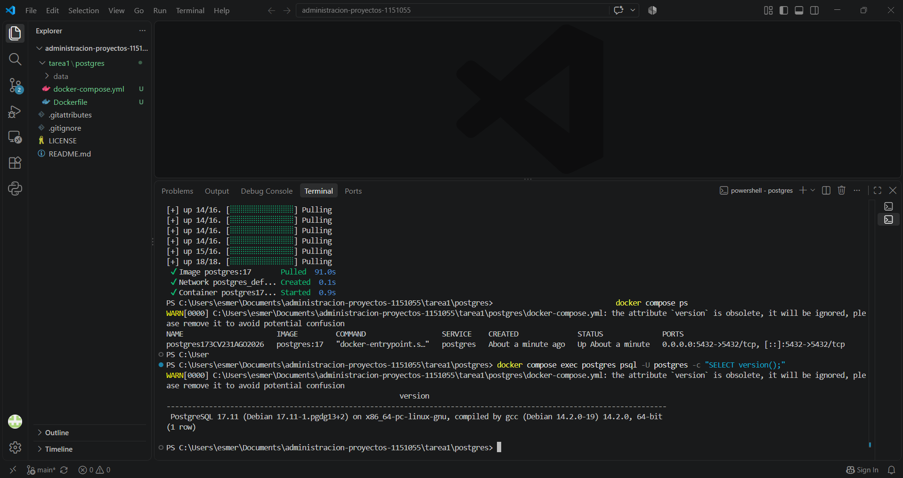
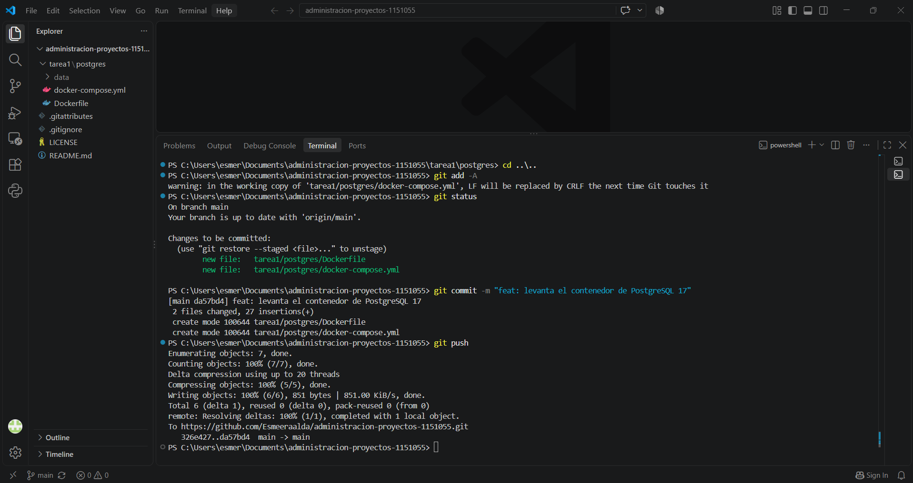
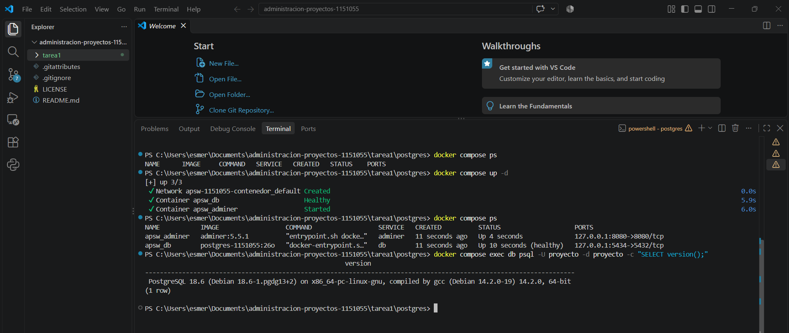
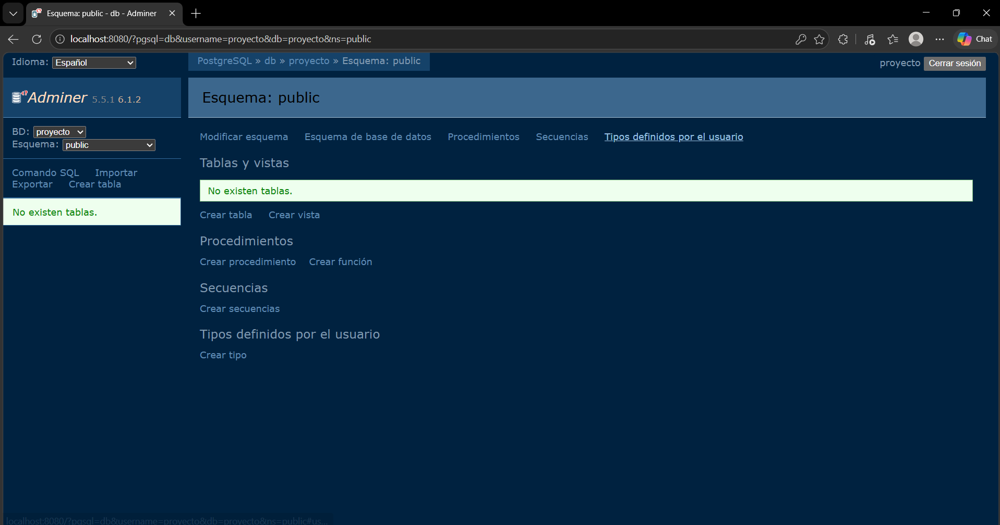
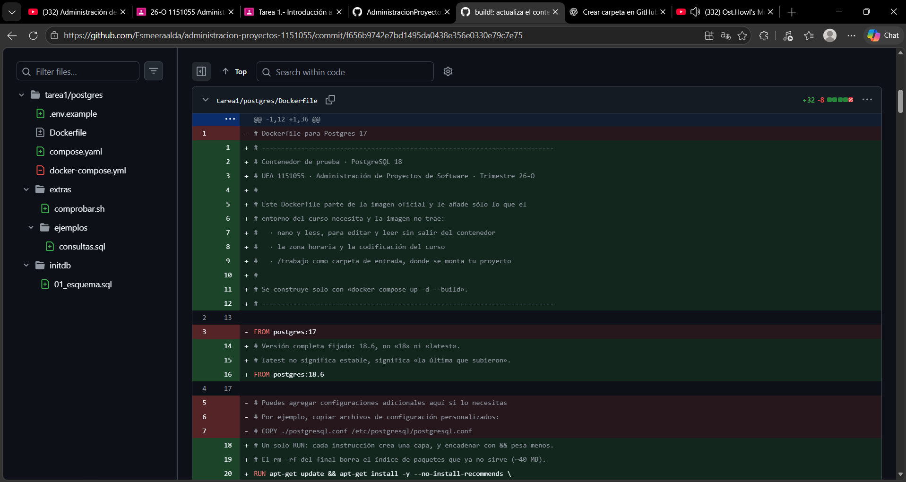
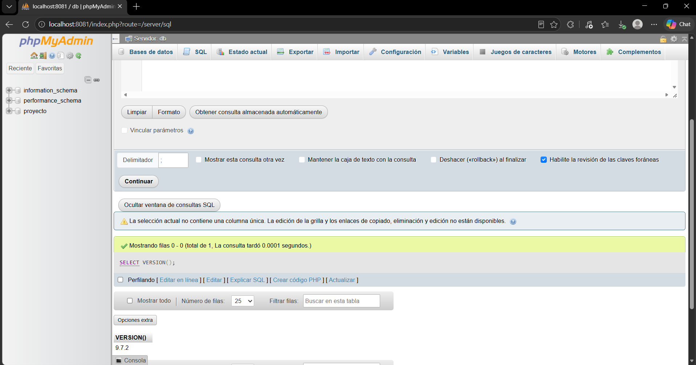
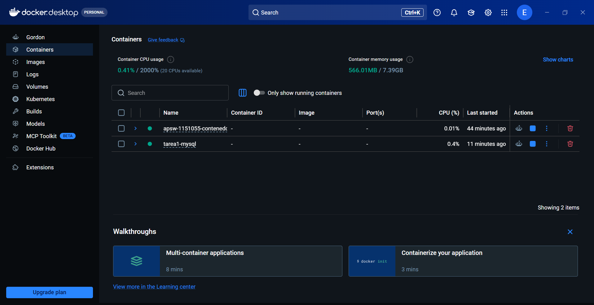
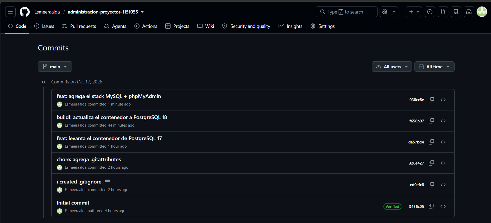

## 1. ¿Qué es un proyecto de software?
es un conjunto de actividades organizadas que se realizan durante un periodo determinado para desarrollar, modificar o mejorar un programa o sistema. Tiene un objetivo específico y busca entregar un resultado que cumpla con las necesidades establecidas.

* Operacion continua:
consiste en actividades que se realizan de manera constante para mantener funcionando un servicio o producto

* Proyecto:
es el trabajo temporal que se realiza para alcanzar un objetivo. Por ejemplo, desarrollar una aplicación móvil.
* Producto:
es el resultado que se obtiene del proyecto. En este caso, la aplicación móvil terminada.
* Proceso:
es el conjunto de actividades o pasos que se siguen para realizar un trabajo. Por ejemplo, analizar los requisitos, diseñar, programar y probar la aplicación.

* Alcance: efine qué funciones y características tendrá el software y qué actividades se deben realizar.
* Tiempo:
Establece cuánto tiempo se necesita para completar el proyecto y sus actividades.
* Costo:
Representa los recursos económicos necesarios para desarrollar el proyecto.
* Calidad: 
Se refiere a que el software cumpla con los requisitos establecidos y funcione correctamente.

## 2. ¿Cómo se administra?
consiste en organizar las actividades, distribuir responsabilidades, establecer tiempos y supervisar el avance del trabajo para alcanzar los objetivos establecidos.

* ¿Que son la guia del PMBOK?

* Scrum:
es un marco de trabajo ágil que permite organizar el desarrollo de sistemas complejos mediante periodos cortos de trabajo llamados Sprints. Durante estos periodos, el equipo selecciona actividades, desarrolla una parte del producto y revisa los resultados para realizar los ajustes necesarios. Utiliza reuniones y elementos de trabajo para organizar las actividades, revisar los avances y mejorar continuamente teniendo un enfoque iterativo e incremental, basado en la transparencia, inspección y adaptación.

* Modelo predictivo:
Se realiza principalmente al inicio.
Se siguen etapas previamente definidas.
Se controlan mediante procedimientos establecidos.
Se busca definirlos desde el principio.

* Modelo iterativo:
Se revisa en cada ciclo.
Se repite el proceso para mejorar el producto.
Se incorporan en ciclos posteriores.
Pueden evolucionar entre iteraciones.

* Modelo agil: 
Se adapta continuamente.
Se realizan entregas frecuentes de incrementos funcionales.
Se aceptan y priorizan durante el desarrollo.
Pueden cambiar conforme se obtiene retroalimentación.

* Modelo para el curso ( justificacion): Elegiría el enfoque ágil, en este caso se utilizaria Scrum , porque un proyecto desarrollado durante el curso puede presentar cambios en los requisitos, correcciones o nuevas necesidades conforme avanza el trabajo.

## 3. ¿Con qué herramientas?
* ¿Para que sirve el control de versiones?:
permite registrar y administrar los cambios realizados en los archivos del proyecto. Facilita recuperar versiones anteriores, identificar quién realizó cada modificación y trabajar con otros integrantes sin perder el historial del proyecto.

* ¿Para que sirven los tableros de trabajo?:
permiten organizar y dar seguimiento a las actividades de un proyecto. Las tareas se pueden clasificar según su estado, por ejemplo: pendientes, en proceso y terminadas.

* ¿Para que sirven los contenedores?:
permiten ejecutar aplicaciones junto con sus dependencias y configuraciones en un entorno aislado. Esto ayuda a que el software funcione de manera consistente en diferentes equipos.

* ¿Para que sirve la integracion continua?:
consiste en incorporar frecuentemente los cambios realizados por los desarrolladores a un repositorio compartido. Cada integración puede activar procesos automáticos, como la compilación y ejecución de pruebas

* Docker frente a una maquina virtual:
Docker aísla aplicaciones, mientras que una máquina virtual emula una computadora completa con su propio sistema operativo

- DOCKER(contenedores): 
Comparte el núcleo del sistema operativo anfitrión.
Generalmente consume menos memoria y almacenamiento.
- Maquina virtual: 
Ejecuta un sistema operativo propio.
Requiere más recursos.

* Docker frente a compose.yaml:
- Docketfile: 
contiene las instrucciones para construir una imagen. Indica qué imagen base utilizar, qué archivos copiar, qué dependencias instalar y qué comando ejecutar.
- compose.yaml : 
define y configura los servicios que forman una aplicación. Permite establecer qué contenedores se ejecutarán, sus puertos, redes, variables de entorno y volúmenes.

* Volumen:
es un mecanismo de almacenamiento administrado por Docker que permite conservar los datos generados por un contenedor, incluso después de eliminarlo.

* Comandos (up -d, exec, stop, down, ps y logs):

| Comando | Descripción |
|---|---|
| `docker compose up -d` | Crea e inicia los contenedores en segundo plano. |
| `docker compose exec` | Ejecuta un comando dentro de un contenedor en funcionamiento. |
| `docker compose stop` | Detiene los contenedores sin eliminarlos. |
| `docker compose down` | Detiene y elimina los contenedores y las redes del proyecto. |
| `docker compose ps` | Muestra los contenedores del proyecto y su estado. |
| `docker compose logs` | Muestra los registros de actividad de los contenedores para revisar su funcionamiento o detectar errores. |

## 4. ¿Bajo qué licencia se distribuye el software?
Una licencia de software es un documento legal que establece las condiciones bajo las cuales otras personas pueden utilizar, modificar y distribuir un programa. También define las obligaciones que deben cumplir quienes reciben o modifican ese software.

* a. Los dos grandes tipos  ( Tabla con lo que permite y exige cada una)
- ¿Que es una licencia permisiva ( MIT, BSD, Apache 2.0)?:
Son licencias que permiten utilizar, modificar y distribuir el software, incluso incorporarlo en productos comerciales o propietarios. Generalmente, exigen conservar los avisos de derechos de autor y las condiciones de la licencia original.
- ¿Que es una copyleft ( GPL, LGPL, AGPL)
Permiten utilizar, modificar y distribuir el software, pero establecen condiciones para conservar las libertades del programa. Dependiendo de la licencia, al distribuir una versión modificada también puede ser obligatorio proporcionar el código fuente bajo la misma licencia o una compatible.

| Licencia | Tipo | Permite uso comercial | Permite modificar el código | Permite distribuir copias | Obligaciones principales |
|---|---|---|---|---|---|
| MIT | Permisiva | Sí | Sí | Sí | Conservar el aviso de derechos de autor y la licencia original. |
| BSD | Permisiva | Sí | Sí | Sí | Conservar los avisos de derechos de autor y las condiciones de la licencia. |
| Apache 2.0 | Permisiva | Sí | Sí | Sí | Incluir una copia de la licencia, conservar los avisos y señalar los cambios realizados. |
| GPL | Copyleft | Sí | Sí | Sí | Al distribuir versiones modificadas, se debe proporcionar el código fuente y mantener la misma licencia. |
| LGPL | Copyleft débil | Sí | Sí | Sí | Mantener la licencia LGPL en la biblioteca y permitir que los usuarios puedan modificarla y reemplazarla. |
| AGPL | Copyleft | Sí | Sí | Sí | Mantener la licencia y ofrecer el código fuente de la versión modificada incluso cuando se utiliza a través de una red. |

* b. Su eleccion
- ¿Por que el repositorio utiliza MIT?
porque es una licencia permisiva que permite compartir el código y que otras personas puedan utilizarlo, modificarlo y distribuirlo sin demasiadas restricciones.

- ¿Que ventajas tiene?
Permite utilizar el código en proyectos personales y comerciales.
Facilita que otras personas puedan modificar y reutilizar los ejercicios.
No obliga a publicar las modificaciones bajo la misma licencia.

- ¿Que cambiaria si hubiera elegido GPL?
Se podria utilizar, modificar y distribuir el código. Sin embargo, si distribuyeran una versión modificada o un trabajo derivado cubierto por esta licencia, se tendría que proporcionar el código fuente correspondiente y mantenerlo bajo GPL.

* c. Caso realreal, a elegir, en que la decisión de la empresa dueña de un proyecto llevó a sus usuarios a crear o adoptar una alternativa:

- MySQL, que pasó a manos de Oracle, y MariaDB.

MySQL es un sistema de gestión de bases de datos relacionales que fue desarrollado originalmente por MySQL AB. En enero de 2008, Sun Microsystems adquirió esta empresa y pasó a controlar el desarrollo de MySQL.
En abril de 2009, Oracle anunció la adquisición de Sun Microsystems. Esta operación generó preocupación entre algunos desarrolladores y usuarios, debido a que Oracle también comercializaba su propio sistema de bases de datos. Existía incertidumbre sobre el futuro de MySQL y sobre las decisiones que Oracle tomaría respecto a su desarrollo.

Ante esta situación, Michael Widenius, uno de los creadores originales de MySQL, inició en 2009 una bifurcación (fork) del proyecto para desarrollar MariaDB. El objetivo era mantener una alternativa independiente, compatible con MySQL y abierta a la participación de la comunidad.
En enero de 2010, Oracle completó la adquisición de Sun Microsystems y pasó a controlar MySQL (MariaDB Foundation, s. f.).

¿Qué licencia tenía MySQL?
MySQL utilizaba un modelo de doble licencia: su edición comunitaria se distribuía bajo la licencia GNU GPL versión 2 (GPLv2), mientras que también existía una licencia comercial para determinados usos y formas de distribución.
MariaDB se publicó bajo GPLv2, manteniendo su carácter de software libre.

¿Por qué la licencia permitió crear MariaDB sin pedir permiso?
La GPLv2 permite utilizar, estudiar, modificar y redistribuir el código fuente de un programa. Por esta razón, los desarrolladores pudieron tomar el código de MySQL publicado bajo GPLv2, modificarlo y crear MariaDB sin necesitar una autorización adicional de Oracle.
La condición era respetar las obligaciones de la licencia, como conservar los avisos correspondientes y distribuir las versiones derivadas bajo GPLv2 cuando se distribuyen a terceros.

### Referencias
- Punto 1. Conceptos de proyectos de software
- Association for Project Management. (s. f.). What is project management? https://www.apm.org.uk/resources/what-is-project-management/
- Project Management Institute. (s. f.). Projects and the project lifecycle.

- Punto 2. Gestión de proyectos
- Project Management Institute. (2021). A guide to the project management body of knowledge (PMBOK® guide) (7th ed.). Project Management Institute.
- Schwaber, K., & Sutherland, J. (2020). The Scrum Guide: The definitive guide to Scrum: The rules of the game. https://scrumguides.org/scrum-guide.html

- Punto 3. Herramientas para la gestión de proyectos
- Docker. (s. f.). What is a container? https://www.docker.com/resources/what-container/
- GitHub. (s. f.). About Git. https://docs.github.com/en/get-started/using-git/about-git
- GitHub. (s. f.). About projects. https://docs.github.com/en/issues/planning-and-tracking-with-projects/learning-about-projects/about-projects
- Ubuntu. (s. f.). What are containers? https://ubuntu.com/containers/what-are-containers

- Punto 4. Licencias de software y casos reales
- MariaDB Foundation. (s. f.). MariaDB in brief. https://mariadb.org/en/
- Oracle. (s. f.). MySQL Community Edition. https://www.mysql.com/products/community/

- Para completar la informacion que faltante se utilizo IA Chatgpt.com 

## Ejercicio 3.
| **Busque…**                     | **Viejo**                         | **Nuevo**                      |
| ------------------------------- | --------------------------------- | ------------------------------ |
| Nombre del archivo              | `docker-compose.yml`              | `compose.yaml`                 |
| Primera línea                   | `version: '3.8'`                  | No hay                         |
| Imagen                          | `postgres:17`                     | `FROM postgres:18.6`           |
| Datos                           | `./data:/var/lib/postgresql/data` | `datos_db:/var/lib/postgresql` |
| Contraseña                      | escrita: `postgres`               | `${POSTGRES_PASSWORD:-...}`    |
| Puerto                          | `"5432:5432"`                     | `"127.0.0.1:5434:5432"`        |
| ¿Sabe si está lista?            | No                                | `healthcheck`                  |
| Interfaz web                    | No                                | Adminer                        |
| La carpeta del proyecto, dentro | No, sólo `data/`                  | `./:/trabajo`                  |

## 2. ¿Se usaba el Dockerfile viejo? Justifíquelo con el docker-compose.yml.

No. El archivo docker-compose.yml utilizaba directamente la imagen postgres:17 mediante image:, sin incluir build: ., por lo que el Dockerfile no se utilizaba.

## 3. ¿Qué es el versionado semántico y por qué pasar de la 17 a la 18 es un cambio mayor?

Es un sistema que identifica las versiones mediante tres números: MAJOR.MINOR.PATCH. Pasar de PostgreSQL 17 a 18 es un cambio mayor porque aumenta el número MAJOR, lo que indica una nueva versión principal que puede incluir cambios incompatibles con la anterior.

## Ejercicio 4

## 1. Tabla comparativa: PostgreSQL + Adminer vs. MySQL + phpMyAdmin

| **Característica** | **PostgreSQL + Adminer** | **MySQL + phpMyAdmin** |
|---|---|---|
| Motor de base de datos | PostgreSQL | MySQL |
| Imagen | `postgres:18.6` | `mysql:9.7.2` |
| Contenedor | `apsw_db` | `tarea1_mysql` |
| Puerto de la base de datos | `5434:5432` | `3307:3306` |
| Base de datos predeterminada | `proyecto` | `proyecto` |
| Carpeta de datos | `/var/lib/postgresql` | `/var/lib/mysql` |
| Interfaz web | Adminer | phpMyAdmin |
| Imagen de la interfaz | `adminer:5.5.1` | `phpmyadmin:5.2.3` |
| Puerto de la interfaz | `8080` | `80` |
| Puerto de acceso local | `8080` | `8081` |
| Comprobación de disponibilidad | `pg_isready` | `mysqladmin ping` |
| Espera a que la base esté lista | `service_healthy` | `service_healthy` |

## 2. ¿Qué es una versión LTS y una Innovation, y por qué se usa mysql:9.7.2 y no mysql:latest?

Una versión LTS ofrece soporte a largo plazo, mientras que una versión Innovation incorpora nuevas funcionalidades con actualizaciones más frecuentes. Se utiliza mysql:9.7.2 para mantener una versión específica y evitar que mysql:latest cambie automáticamente a una versión diferente.

## Evidencias

### 1. PostgreSQL 17: construcción del contenedor

### 2. PostgreSQL 17: comprobación del contenedor

### 3. PostgreSQL 18: comprobación del contenedor

### 4. PostgreSQL 18: Adminer

### 5. Diferencias de PostgreSQL 18 en GitHub

### 6. MySQL: phpMyAdmin

### 7. Docker Desktop: contenedores encendidos

### 8. Historial de confirmaciones en GitHub
